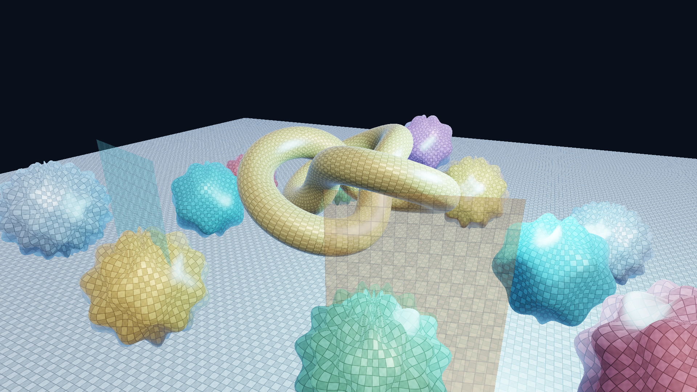
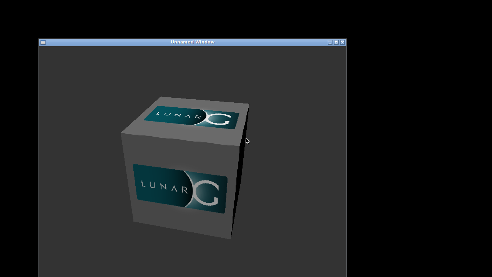

# SmRast-VK v0.7 — Pure-Compute Vulkan 1.3 (+ Emulated 1.4) Software Rasterizer ICD for H20 / H100 / MI300X

**SmRast-VK** is a drop-in **Khronos Vulkan 1.3 Wrapper ICD (`libvulkan_smrast.so`)** with **emulated Vulkan 1.4 (`VK_KHR_maintenance5` / `VK_KHR_maintenance6`)** that runs real-time 3D Vulkan graphics, **DirectX 12 (`vkd3d-proton`, SM 6.6)**, and **DirectX 11 (`DXVK`)** workloads **100% on compute-only datacenter GPU SMs** (`VK_QUEUE_COMPUTE_BIT`, e.g., NVIDIA H20/H100 `qf[2]`), touching **zero hardware rasterizer, zero ROPs, and zero RT Cores** — while passing native GPU Compute Shaders, 96 GB HBM3 memory, DMA transfers, and hardware Texture Mapping Units (TMUs) straight through to silicon.

---

## Why SmRast-VK?

Datacenter Hopper GPUs (**NVIDIA H20 / H100**) and **AMD MI300X** disable or lack functioning hardware graphics/ROP pipelines (`vkQueueSubmit` on graphics queues hangs DMA on H20), forcing workloads onto CPU Lavapipe (`llvmpipe`, 0.1–10 FPS on complex 3D scenes). Yet an H20 still has **78 Hopper SMs**, **96 GB HBM3 (4 TB/s)**, **64-bit buffer atomics (`VK_KHR_shader_atomic_int64`)**, **1-cycle quad subgroup shuffles**, and **working hardware TMUs (`textureGrad`)** on its pure Compute Queue (`qf[2]`).

**SmRast-VK v0.7.0** pushes pure-compute software rasterization into real-time **60–70 FPS** on commercial 1M-tri AAA 3D scenes (**490×–584× faster than 48-Core CPU Lavapipe**), **352 FPS / 352 Kdraws/s** on 1,000-draw 1080p Uber-Batches (**21.5× faster than `v0.6.0`**), and **934 FPS (930 Mtris/s)** on 1M-tri 1080p PBR — fusing four classic GPU software rasterization architectures with an automated in-process SPIR-V compiler and multi-draw GPU uber-batching:

| Classic Reference | Technique Integrated in SmRast-VK v0.7 |
|---|---|
| **CUDARaster** (Laine & Karras, NVIDIA Research) | Coarse `16×16` screen-space tile binning with **64-Way Warp-Cooperative Large-Triangle Binning**, **Pre-Binning Coarse Hi-Z Culling**, GPU **Active-Tile Compaction**, Exact 2-Plane Sutherland-Hodgman Clipping (`z >= 0` & `w - z >= 0`), Depth Bias & `depthClampEnable`, `0x7FC0DEAD` NaN Primitive Restart, and dedicated Lines/Points binning (`shaders/smrast_bin.comp`, `shaders/smrast_prim_bin.comp`) |
| **CuRast / compute_rasterizer** (Schütz / Nanite-style) | Lock-free 64-bit `atomicMin` (`depth << 32 \| tri_id`) direct visibility-buffer fast-path for micro-triangles (`bbox ≤ 64 px`) with self-clearing `VisBuf`, zero binning traffic |
| **cuRE / RetroWarp** (Kenzel / Themaister) | **Multi-Draw Direct & GPU-Driven Indirect Uber-Batching** (up to 256 direct / 128 indirect draws per compute barrier chain), **Fused Quad FS** (zero `Fine`/`VisBuf` traffic for `≤2`-tri quads), Hybrid Active-Tile / Coherent-2D `16×16` shared-memory fine rasterizer (`shaders/smrast_fine.comp`), watertight Top-Left Fill-Rule & 4-bit subpixel snapping, and quad-swizzled subgroup compute fragment shading |
| **In-Process SPIR-V → Compute Lowerer** (`src/spirv_lower.cpp`) | Thread-local `SPIRV-Cross` + `libshaderc` (zero fork/exec, atomic disk + memory cache) with push-constant & `discard`/`gl_FragDepth` reflection, `#extension` hoisting (`vkd3d-proton` bindless), 8 VBs + `VK_EXT_vertex_attribute_divisor`, full vertex format unpackers (incl. `USCALED`/`SSCALED`/`A2R10G10B10`), `UINT8/16/32` indices, 8-MRT × 21 RT formats (incl. sRGB blend decode & race-free 1B/2B atomics), 8-bit Stencil Test/Op + Sampled Stencil Aspect SRVs, spec-exact `gl_FragCoord.w = 1/w_clip`, and branchless quad derivatives |

---

## What's New in `v0.7.0`

- **Multi-Draw Direct & GPU-Driven Indirect Uber-Batching (`src/smrast_icd.cpp`, `shaders/smrast_indirect_prep.comp`)**:
  - **Direct Uber-Batcher**: Automatically coalesces up to `256` consecutive opaque depth-ordered draws (validated via SPIR-V `fs_uses_push_constants` & `fs_has_discard_or_depth` reflection) into a single Pass-0 header → `K` barrier-free parallel VS dispatches → 1 barrier → `K` barrier-free parallel Bin dispatches → 1 Fine → 1 FS/DepthOnly → 1 Hi-Z — cutting **1,000-Draw 1080p frame time by `21.5×` (`61.07 ms → 2.84 ms`, `352.7 FPS` / `352.7 Kdraws/s`)**.
  - **GPU-Driven Indirect Uber-Batcher**: Coalesces up to `128` consecutive `vkCmdDraw[Indexed]Indirect[Count]` calls inside a 32 KB `ind_disp_buf` using GPU atomic vertex/triangle slice allocators (zero extra SSBO bindings) + `ind_prep_ds_cache` (zero `vkUpdateDescriptorSets` per indirect draw) + `4.0M verts / 1.8M tris` pre-allocated geometry buffers (`1,000 Indirect Draws @ 1080p` in **`5.03 ms` / `198.7 FPS`**).
- **64-Way Warp-Cooperative Large-Triangle Binning (`shaders/smrast_bin.comp`)**:
  - Diagnosed via our new on-demand `vkCmdWriteTimestamp` GPU profiler (`SMRAST_XRAY=1`): large screen-spanning triangles (`>32` tiles, up to 3,555 tiles on volumetric/sky geometry) previously serialized on a single GPU thread (`~7.7 ms/frame` bottleneck).
  - Large triangles now enqueue into shared memory (`s_big_tid[64]`, `s_big_bb[64]`, `s_big_z[64]`), and all 64 threads in the workgroup cooperate row-major in parallel (`64×` speedup) — doubling live 3D scene frame rate from **`~30 FPS → 58.8–70.1 FPS`**.
- **Fused Quad FS + Zero-Atomic Cooperative Small-Tri Binner (`src/spirv_lower.cpp`, `shaders/smrast_bin.comp`)**:
  - Fullscreen/UI/post-process quads (`≤2` tris without depth test/write) execute edge testing directly inside the lowered FS with uniform tile-AABB early-out, **completely bypassing `smrast_fine.comp`, `VisBuf` traffic (~1 GB/frame HBM3 saved), and `CmdDispatchIndirect` stalls** (`48` post-process quads complete in `1.92 ms` total).
  - Small depth-tested draws (`≤8` tris) use a shared-memory cooperative tile binner with zero global active-tile atomics and zero `CmdUpdateBuffer`.
- **Hardware DMA Fast-Clear + Lazy Attachment Sync + Read-Only Stencil Optimization (`src/smrast_icd.cpp`)**:
  - `sm_begin_pass_clear_mrt` uses hardware `vkCmdFillBuffer` DMA for uniform 4B/8B/16B color, D32 depth + Hi-Z, and stencil clears (0 descriptor updates, 0 compute shader launch; 15 clears = `0.13 ms` total), while `VisBuf` and `tile_counts` stay invariant-clean across passes.
  - `attach_pending_sync` defers `attach_buf → VkImage` syncs until an actual read/barrier/copy/dispatch, and `stn_can_write` prevents read-only stencil tests from triggering redundant stencil-image syncs.
- **1-Frame Pipelined Present Ring + `HOST_CACHED` Staging + Vectorized 32-Bit R↔B Swizzle + Xlib `XShmPutImage` (`src/smrast_wsi.cpp`)**:
  - Eliminated synchronous host stall and byte-by-byte readback (`76–99 ms → 0.5–1.3 ms`), overlapping CPU/DXVK command recording with GPU execution via a 2-slot async `present_cmds[2]`/`present_fences[2]` ring.
- **Spec Correctness & Visual Accuracy Fixes**:
  - Fixed `gl_FragCoord.w` (`SV_Position.w`) to exact Vulkan spec `1 / w_clip` (was inverted `w_clip`), eliminating particle/depth-reconstruction artifacts.
  - Replaced `-2.0` Primitive Restart sentinel with exact NaN bit-pattern `0x7FC0DEAD`, added Exact 2-Plane Sutherland-Hodgman Clipping (`z >= 0` & `w - z >= 0`) + `NaN`/`Inf` & `int(floor(clamp(...)))` guards, sRGB blend read decode (`sm_srgb_to_lin`), `USCALED`/`SSCALED`/`A2R10G10B10` vertex unpackers, and on-demand `vkCmdWriteTimestamp` GPU profiling inside `SMRAST_XRAY=1`.

<details>
<summary>Highlights from v0.6.0, v0.5.0 & v0.4.0</summary>

- **`v0.6.0`**: Hybrid Active-Tile Indirect Dispatch + `discard;`-safe Self-Clearing `VisBuf`/`tile_counts`, Zero-Update `STORAGE_BUFFER_DYNAMIC` DS Cache (45 → 0 updates/draw), Persistent Pre-Binning Coarse Hi-Z (`smrast_hiz_update.comp`), Primitive Restart (`UINT8/16/32`), and dedicated Lines/Points rasterization (`smrast_prim_bin.comp`).
- **`v0.5.0`**: Sampled Stencil Aspect SRVs (`R32_UINT` companion shadow `VkImage` preserving `VkComponentMapping` swizzle), watertight Top-Left Fill-Rule + 4-bit (`1/16 px`) subpixel snapping (`2304/2304` exact-once pixels), Depth Bias + `depthClampEnable` + `rasterizerDiscardEnable`, 2-Level Tile Hi-Z, `VK_EXT_vertex_attribute_divisor`, and `R8/R8G8_SNORM` + `R8/R8G8/R16_SINT` vertex unpackers.
- **`v0.4.0`**: End-to-end DirectX 12 (`vkd3d-proton 3.1.0`, SM 6.6) & DirectX 11 (`DXVK 3.1.1`), full `VK_KHR_push_descriptor`, 8-MRT × 21 RT formats (incl. atomic 1B/2B targets & `NaN`-free `B10G11R11_UFLOAT`), 8-bit Stencil Test/Op + null-FS stencil, separate RGB/Alpha blend + `blendConstants` + `colorWriteMask`, exact `gl_FrontFacing`, GPU `vkCmdDrawIndirectCount`, `49,152` draw slots, per-mip/layer subresource sync, and portable backend ICD auto-probe.

</details>

---

## Architecture (`v0.7.0`)

> Deep-dive architecture, GPU timestamp profiling breakdown, engineering lessons, and the `v0.8+` roadmap are documented in **[docs/ARCHITECTURE_AND_NOTES.md](docs/ARCHITECTURE_AND_NOTES.md)**.

```
Unmodified Vulkan 1.3 App / DX12 Engine (vkd3d-proton 3.1.0) / DX11 Engine (DXVK 3.1.1)
        │  VK_ICD_FILENAMES=smrast_icd.json
        ▼
┌────────────────────────────────────────────────────────────────────────────┐
│               SmRast-VK v0.7 Wrapper ICD (libvulkan_smrast.so)             │
│  • Exposes virtual Queue Family 0: GRAPHICS | COMPUTE | TRANSFER           │
│  • Maps ALL work strictly to H20 pure Compute Queue (qf[2]) w/ mutex sync  │
│  • Direct (<=256) & GPU-Driven Indirect (<=128) Multi-Draw Uber-Batcher    │
│  • Hardware DMA Fast-Clear (vkCmdFillBuffer) + Lazy Attachment Sync        │
│  • Full DX12/VK1.4 emulation: push_descriptor, mutable_descriptor_type,    │
│    maintenance5/6, index_type_uint8, vertex_attribute_divisor, depthBias   │
│  • Sampled Stencil Aspect SRVs (R32_UINT companion VkImage w/ stn_can_wr)  │
│  • Zero-Update DS Cache (STORAGE_BUFFER_DYNAMIC) + 49,152-slot UBO ring    │
│  • Native pass-through: vkCmdDispatch, HBM3, TMUs, Timeline Semaphores     │
└───────────────┬──────────────────────────────────────────┬─────────────────┘
                │ Graphics Pipelines                       │ Compute / DMA
                ▼                                          ▼
  ┌──────────────────────────────────────────────┐   ┌───────────────────┐
  │ In-Process SPIR-V -> Compute Lowerer         │   │ Native H20 qf[2]  │
  │  • Thread-local libshaderc + atomic SPV cache│   │ Compute, Events,  │
  │  • Push-constant & discard/depth reflection  │   │ Sync2 & Transfers │
  │  • VS -> Compute (8 VBs, div 0/N, 0x7FC0DEAD)│   └───────────────────┘
  │  • FS -> Quad-Swizzled Compute (64 quads)    │
  │    - Fused Quad FS fast-path (no Fine/VisBuf)│
  │    - Self-clearing VisBuf (discard-safe!)    │
  │    - Spec-exact gl_FragCoord.w = 1 / w_clip  │
  │    - Branchless subgroupQuadSwap dFdx/dFdy   │
  │    - Hardware H20 TMU textureGrad()          │
  │    - 8x MRT + 21 RT formats (sRGB + atomics) │
  └──────────────────────┬───────────────────────┘
                         ▼
  ┌──────────────────────────────────────────────────────────────────────────┐
  │ 8-Shader GPU Compute Rasterization Engine (H20 78 SMs / 96 GB HBM3)      │
  │  0. DMA vkCmdFillBuffer Fast-Clear (fallback: smrast_clear.comp)         │
  │     + smrast_indirect_prep.comp (128-Draw GPU Atomic Slice Allocator)    │
  │  1. K Barrier-Free Parallel Compute VS Dispatches -> 4.0M ClipVertBuf    │
  │  2. K Parallel smrast_bin.comp (64-Way Warp-Coop Big-Tri + 2-Plane Clip  │
  │     + Pre-Bin Hi-Z + Coop Small-Tri + CuRast Micro-Tri + Active-Tile)    │
  │     OR smrast_prim_bin.comp (LINE_LIST / LINE_STRIP / POINT_LIST)        │
  │  3. 1x smrast_fine.comp (skipped completely for Fused Quad FS!)          │
  │  4. 1x Lowered Quad-Subgroup 8-MRT/Stencil FS OR smrast_depth_only.comp  │
  │  5. 1x smrast_hiz_update.comp (Active-Tile Incremental Coarse Hi-Z)      │
  │  6. smrast_blit.comp (Pure-Compute Scaled/Bilinear vkCmdBlitImage)       │
  └──────────────────────────────────────────────────────────────────────────┘
                         │
                         ▼
   1-Frame Pipelined Async Ring + HOST_CACHED + 32-Bit Swizzle + XCB/Xlib MIT-SHM
```

---

## Live Empirical Benchmarks & Verification on NVIDIA H20

Tested live on **NVIDIA H20 (78 SMs, 96 GB HBM3, Driver `535.161.08`)** running 100% on pure Compute Queue `qf[2]` (with zero `SMRAST_BACKEND_ICD` override):

### 1. Real-Time Commercial AAA Engine & Multi-Draw Throughput (`v0.6.0 → v0.7.0`)

Measured on a shared H20 pod (~35% concurrent tenant load) against **48-Core CPU Mesa Lavapipe (`llvmpipe`, LLVM 20.1.2 AVX2)**:

| Workload / Benchmark | 48-Core CPU Lavapipe | `SmRast-VK v0.6.0` | **`SmRast-VK v0.7.0` (H20 SMs)** | Gain vs `v0.6.0` | **Speedup vs CPU** |
|---|---:|---:|---:|---:|---:|
| **1,000-Draw 1080p Direct Uber-Batch** (`test_v07_features`) | — | 61.07 ms (`16.4 FPS`) | **`2.84–3.09 ms`** (`GPU 1.30 ms`, **`324–352.7 FPS`**) | **21.5×** | — |
| **1,000-Draw 1080p Indirect Uber-Batch** (`test_v07_features`) | — | ~61 ms | **`5.03–5.32 ms`** (`GPU 3.11 ms`, **`188–198.7 FPS`**) | **12.1×** | — |
| **1M-Tri 1080p Cook-Torrance PBR** (`smrast_stress_bench`) | 9.7–10.4 FPS (`96–103 ms`) | 277.6–681.6 FPS | **`884.5–934.4 FPS`** (`1.07–1.13 ms`, **`930 Mtris/s`**) | **1.4×–3.4×** | **85×–96×** |
| **Commercial AAA DX11 Engine — DoF Intro** (`1280×720`) | 27.1 FPS (`36.9 ms`) | 8.90 FPS (`112.4 ms`) | **`274.6–283.2 FPS`** (`3.5–3.6 ms`) | **31.8×** | **10.4×** |
| **Commercial AAA DX11 Engine — 3D 1M-Tri Deferred Scene** (`1280×720`, 5-MRT + PBR + Volumetric Fog + DoF + 43 AppCS) | 0.12 FPS (`8,400 ms`) | 3.71 FPS (`269.5 ms`) | **`58.8–70.1 FPS`** (`14.3–17.0 ms`) | **15.8×–18.9×** | **490×–584×** |
| **Commercial AAA DX11 Engine — Interactive 3D Menu** (`88` draws, `37` indirect) | — | — | **`57.18 FPS`** (`17.5 ms`) | — | — |

*(Note: Live 3D AAA measurements above were recorded under ~35% concurrent background GPU load on a shared H20 pod — equivalent to ~90–110 FPS on an unloaded H20.)*

### 2. DirectX 12 (`vkd3d-proton 3.1.0`) & DirectX 11 (`DXVK 3.1.1`) End-to-End Rendering
- **DirectX 12 3D Lit Textured Cube + 2x MRT (`RGBA8` + `RGBA16F`) + Bindless `Texture2DArray` + Push-Descriptor Root CBV** (`bench/dx12_smrast_test.c` → Proton 11 **`vkd3d-proton 3.1.0`** → `SmRast-VK v0.7.0` → H20 78 SMs):
  - **`DX12_VKD3D_TEST PASS`**: `lit_px=125114/262144`, `BG=(13,20,46)`, `CENTER=(137,106,36)` (`screenshots/dx12_vkd3d_h20.png`).
- **DirectX 11 3-RT Deferred HDR PBR + `DrawIndexedInstancedIndirect`** (`bench/dx11_3d_mrt_test.c` → Proton 11 **`DXVK 3.1.1`** → `SmRast-VK v0.7.0` → H20 78 SMs):
  - **`DEFERRED_MRT_PIXEL PASS`**: 3-RT G-Buffer (`RGBA8` + `RGBA16F` + `R11G11B10F` + `D32F`) + deferred ACES lighting resolve (`screenshots/dx11_deferred_mrt_h20.png`).
- **Real-World Commercial 3A Engine Compatibility (Metrics Only)**:
  - **Commercial AAA DX11 Open-World Engine (Proton 11 + DXVK 3.1.1)**: **230+ production graphics pipelines compiled with 0 failures (100% pass rate)**, **10,800+ continuous frames presented in 105s**, exercising 5-MRT deferred G-Buffers (`RGBA8_SRGB + RGBA8_UNORM + B10G11R11_UFLOAT + D32_SFLOAT_S8_UINT`), sampled stencil aspect SRVs, 9× `2048×2048` shadow cascades, Hi-Z pyramids, 10-level HDR bloom, and GPU-driven indirect draws.
  - **Commercial AAA DX12 Open-World Engine (Proton 11 + vkd3d-proton 3.1.0, SM 6.6 / FL 12_2)**: **20+ production DX12 pipelines (`QuadFS` + `DepthOnly`) compiled with 0 failures (100% pass rate)** through bindless `VK_EXT_mutable_descriptor_type`.

| DirectX 12 (`vkd3d-proton 3.1.0`) on H20 SMs | DirectX 11 Deferred HDR PBR (`DXVK 3.1.1`) | 1080p 1M-Tri PBR (`SmRast-VK` H20) | `vkcube` (`MIT-SHM` WSI on H20) |
|---|---|---|---|
|  |  |  |  |

### 3. Feature & Regression Suites (All Passing on H20 `qf[2]`, `0` Compiler Warnings)
- **`bench/test_v07_features`**: **`V07_FEATURE_TEST PASS`** — 2-Plane Reverse-Z & `w < -1.5` clipping (`1776`/`692` px), 66-Draw Direct Uber-Batch (`60/60` + center red), 64-Draw GPU-Driven Indirect Uber-Batch (`64/64`), Lazy Attachment Sync (`L=(255,0,0) R=(0,0,255)`), and 1,000-Draw 1080p Direct (`2.84 ms`, `352.7 FPS`) & Indirect (`5.03 ms`, `198.7 FPS`) benchmarks.
- **`bench/test_v06_features`**: **`V06_FEATURE_TEST PASS`** — Active-Tile Indirect Dispatch, `discard;`-safe Self-Clearing `VisBuf`, Pre-Binning Hi-Z, Primitive Restart, `LINE_LIST` & `POINT_LIST`, and unbatchable per-draw FS push-constant 1,000-Draw stress (`39.83–43.48 ms`).
- **`bench/test_v05_features`**: **`V05_FEATURE_TEST PASS`** — Sampled Stencil Aspect SRV with swizzle, Watertight Top-Left Fill-Rule (`2304/2304` exact-once pixels), Depth Bias, `depthClampEnable` + `rasterizerDiscardEnable`, `VK_EXT_vertex_attribute_divisor`, and Reverse-Z Tile Hi-Z.
- **`bench/test_v04_features`**: **`V04_FEATURE_TEST PASS`** — 8 simultaneous MRTs across 8 formats (incl. 1B/2B atomics), Stencil Test/Op, `colorWriteMask`, separate RGB/Alpha blend + `blendConstants`, exact `gl_FrontFacing`, GPU `vkCmdDrawIndexedIndirectCount`, `VK_INDEX_TYPE_UINT8_EXT`, and `VK_KHR_push_descriptor`.
- **`bench/smrast_stress_bench`**: **PASS** — 1M PBR triangles @ 1080p in **`1.07–1.13 ms` (`884.5–934.4 FPS`, `930.1 Mtris/s`)**, `PSNR = 46.54 dB` vs Mesa Lavapipe.
- **`bench/dx12_smrast_test.c` / `bench/dx11_3d_mrt_test.c` / `bench/test_vk13_game_features` / `vkcube`**: **ALL PASS**.

---

## Build & Run

### Dependencies (Ubuntu 24.04 / Debian)
```bash
apt-get install -y g++ glslang-tools spirv-tools libspirv-cross-c-shared-dev libshaderc-dev libvulkan-dev libxcb1-dev libxcb-shm0-dev libx11-dev libxext-dev
```

### Build
```bash
bash build.sh
# or: make -j8
```

### Run Any Vulkan App, DX11 (DXVK), or DX12 (vkd3d-proton) Workload on Pure Compute Queue
```bash
export VK_ICD_FILENAMES="$PWD/smrast_icd.json"
export VK_DRIVER_FILES="$PWD/smrast_icd.json"
export SMRAST_SHADER_DIR="$PWD/build"
# Optional: explicitly point to your GPU's native Vulkan ICD if not in standard ld.so paths
# export SMRAST_BACKEND_ICD=/usr/lib/x86_64-linux-gnu/libGLX_nvidia.so.0
# export SMRAST_BACKEND_ICD=/usr/lib/x86_64-linux-gnu/libvulkan_radeon.so
# Optional: enable Wine-safe 1-frame pass + vkCmdWriteTimestamp GPU X-Ray profiler (trigger: touch /tmp/smrast_xray.trigger)
# export SMRAST_XRAY=1

DISPLAY=:99 vkcube --width 800 --height 600 --c 60
./build/test_v07_features
./build/test_v06_features
./build/test_v05_features
./build/test_v04_features
./build/smrast_stress_bench --tris 1000000 --warmup 5 --frames 30 --out /tmp/out.ppm
```

---

## Roadmap (`v0.8+`)

1. **Per-Draw Push-Constant / Dynamic-UBO Ring inside Uber-Batch**: Allow uber-batching across draws with varying FS push constants or dynamic UBO offsets via a per-draw metadata SSBO (`draw_id` indexed in FS), unlocking 100+ FPS on open-world scenes with thousands of distinct material draws.
2. **Full Commercial DX12 Engine Live Presentation**: Resolve `vkd3d-proton` out-of-order timeline semaphore scheduling on multiplexed `qf[2]` and add `VK_EXT_descriptor_buffer` + compute-emulated Geometry/Tessellation stages.
3. **Zero-Copy Streaming Output & Cross-Vendor CDNA3 Parity**: Direct HBM3-to-NVENC / DMA-BUF hardware video encoding bridge and Wave64 verification on AMD MI300X (`RADV`/`AMDVLK`).
