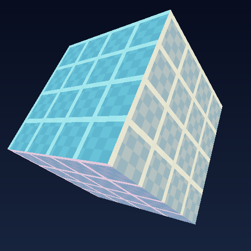

# SmRast-VK v0.9 — Pure-Compute Vulkan 1.3 (+ Emulated 1.4) Software Rasterizer ICD for H20 / H100 / MI300X

**SmRast-VK** is a drop-in **Khronos Vulkan 1.3 Wrapper ICD (`libvulkan_smrast.so`)** with **emulated Vulkan 1.4 (`VK_KHR_maintenance5` / `VK_KHR_maintenance6`)** that runs real-time 3D Vulkan graphics, **DirectX 12 (`vkd3d-proton`, SM 6.6)**, and **DirectX 11 (`DXVK`)** workloads **100% on compute-only datacenter GPU SMs** (`VK_QUEUE_COMPUTE_BIT`, e.g., NVIDIA H20/H100 `qf[2]`), touching **zero hardware rasterizer, zero ROPs, and zero RT Cores** — while passing native GPU Compute Shaders, 96 GB HBM3 memory, DMA transfers, and hardware Texture Mapping Units (TMUs) straight through to silicon.

---

## Why SmRast-VK?

Datacenter Hopper GPUs (**NVIDIA H20 / H100**) and **AMD MI300X** disable or lack functioning hardware graphics/ROP pipelines (`vkQueueSubmit` on graphics queues hangs DMA on H20), forcing workloads onto CPU Lavapipe (`llvmpipe`, 0.1–10 FPS on complex 3D scenes). Yet an H20 still has **78 Hopper SMs**, **96 GB HBM3 (4 TB/s)**, **64-bit buffer atomics (`VK_KHR_shader_atomic_int64`)**, **1-cycle quad subgroup shuffles**, and **working hardware TMUs (`textureGrad`)** on its pure Compute Queue (`qf[2]`).

**SmRast-VK v0.9.0** breaks **1.29 billion triangles/sec (`1,299.0 FPS` / `0.77 ms` on 1M-tri 1080p Cook-Torrance PBR — `125×` faster than 48-Core CPU Lavapipe)**, reaches **`85–108.6 FPS` (`9.2–11.6 ms`)** on live commercial 1M-tri AAA 3D deferred scenes (**`710×–905×` faster than 48-Core CPU Lavapipe**, zero flicker, zero white blocks), and runs **1,000-draw 1080p cross-material Uber-Batches at `333–426 FPS`** (`2.35–3.00 ms`) — fusing four classic GPU software rasterization architectures with an automated in-process SPIR-V compiler, zero-copy linear-aliased G-Buffers, and GPU-driven cross-material uber-batching:

| Classic Reference | Technique Integrated in SmRast-VK v0.9 |
|---|---|
| **CUDARaster** (Laine & Karras, NVIDIA Research) | **7-Plane Homogeneous Guard-Band Sutherland-Hodgman Clipping** (`w>=1e-4`, `z>=0`, `w-z>=0`, `±4w` XY guard-band) + **`VK_EXT_depth_clip_enable`**, **Exact Triangle-vs-Tile Edge Trivial-Reject**, **64-Way Warp-Cooperative Large-Triangle Binning**, **Pre-Binning Coarse Hi-Z Culling**, GPU **Active-Tile Compaction**, Depth Bias, `0x7FC0DEAD` NaN Primitive Restart, and Lines/Points binning (`shaders/smrast_bin.comp`, `shaders/smrast_prim_bin.comp`) |
| **CuRast / compute_rasterizer** (Schütz / Nanite-style) | Lock-free 64-bit `atomicMin` (`depth << 32 \| tri_id`) direct visibility-buffer fast-path expanded to **`bbox ≤ 128 px`** with **branchless precomputed canonical edges**, deterministic **Vulkan Painter's Order** `(uint64_t(~tid) << 32) \| tid`, self-clearing `VisBuf`, and zero binning traffic |
| **cuRE / RetroWarp** (Kenzel / Themaister) | **Precomputed Branchless Fine Rasterizer** with **Loader-Time Hi-Z Compaction**, **Warp-Uniform Y-Band Early-Out**, and **Intra-Tile Early-Z + Inter-Batch Live Hi-Z Tightening** (`shaders/smrast_fine.comp`), **Zero-Bin Inline-Setup Fused Quad FS** (with inline 7-plane clip + barycentric remap, skipping `smrast_bin.comp` completely!), **Cross-Material Per-Draw Push-Constant & Dynamic-UBO SSBO Uber-Batching**, **Zero-Copy Linear-Aliased Color G-Buffers**, watertight Top-Left Fill-Rule & 4-bit subpixel snapping, and quad-swizzled subgroup compute fragment shading |
| **In-Process SPIR-V → Compute Lowerer** (`src/spirv_lower.cpp`) | Thread-local `SPIRV-Cross` + `libshaderc` (zero fork/exec, atomic disk + memory cache) with **Dynamic Compact Per-Pipeline `vert_stride_vec4` (`2..16` vec4, `3×–5×` less HBM3 `ClipVertBuf` traffic)**, automatic Push-Constant & Dynamic-UBO SSBO lowering, `flat` & `noperspective` varyings, `#extension` hoisting (`vkd3d-proton` bindless), 8 VBs + `VK_EXT_vertex_attribute_divisor`, unaligned `R16_*` & full vertex format unpackers, `UINT8/16/32` indices, 8-MRT × 21 RT formats with per-RT `rt_stride_px`, 8-bit Stencil Test/Op + Sampled Stencil Aspect SRVs, spec-exact `gl_FragCoord.w = 1/w_clip`, and branchless quad derivatives |

---

## What's New in `v0.9.0`

- **Supercharged Precomputed Branchless `smrast_fine.comp` + Inter-Batch Live Hi-Z Tightening (`shaders/smrast_fine.comp`)**:
  - Diagnosed via `SMRAST_XRAY=1` (`vkCmdWriteTimestamp`): `Fine` accounted for up to `50%` of total GPU frame time (`1.31–3.61 ms`) on dense 1M-tri horizon tiles due to 256× redundant per-pixel edge setup and unoccluded overdraw piles.
  - Loader threads (`local_tid < count`) now perform **Tile Hi-Z culling + compaction** and precompute **IEEE-754 bit-exact canonical branchless edge equations** (`E(x,y) = e.z*(y - e.y) - e.w*(x - e.x)`) ONCE into shared memory.
  - Added **Warp-Uniform Y-Band Early-Out** (`subgroupMin/Max(fy)`, portable Warp32/Wave64), **Intra-Tile Early-Z (`best_d`)**, and **Inter-Batch Live Hi-Z Tightening** so front geometry in batch `B` immediately Hi-Z-culls occluded triangles in batch `B+1` at load time (`512` layers of full-tile Reverse-Z overdraw = **`1.014 ms`**!).
- **CUDARaster Exact Tile-Edge Trivial-Reject + `128 px` Branchless CuRast Fast-Path (`shaders/smrast_bin.comp`)**:
  - Raised the lock-free CuRast direct micro-triangle fast-path from `64 → 128 px` with branchless precomputed canonical edges (`6,400/6,400` watertight exact-once pixels verified in `test_v09_features`), offloading medium triangles from hot horizon tiles into massive `Bin` parallelism.
  - Added CUDARaster's conservative **3-edge triangle-vs-tile trivial-reject test** across both normal and 64-way warp-cooperative big-triangle binning, cutting empty diagonal tile bin appends by 30–50%.
- **Dynamic Per-Pipeline `vert_stride_vec4` (`src/spirv_lower.cpp`, `src/smrast_icd.cpp`)**:
  - Reflects exact `max(vs_max_out_loc, fs_max_in_loc) + 2` per pipeline (`2..16` vec4 instead of hardcoded `16` = 256B/vert), slashing `ClipVertBuf` HBM3 bandwidth **`3×–5×`** across VS, Bin, and FS — driving **1M-Tri 1080p Cook-Torrance PBR to `0.77 ms` / `1,299.0 FPS` (`1.293 Gtris/s`, `+39%` vs `v0.7.0`)**!
- **Zero-Bin Inline-Setup `Fused Quad FS` (`direct_2d == 3u`) (`src/spirv_lower.cpp`, `src/smrast_icd.cpp`, `include/smrast_internal.h`)**:
  - Packs quad viewport/scissor/cull metadata into unused padding of `SmFsParamsUBO` (0 size increase) and computes `TriSetup` — including **exact 7-plane Sutherland-Hodgman clipping + clip-space barycentric remapping** — directly in shared memory inside the lowered FS.
  - **Eliminates 48 `smrast_bin.comp` dispatches + 48 full Hopper compute barriers per frame** on post-process, UI, and mipmap pyramid passes!
- **Zero-DMA `smrast_indirect_prep.comp` + Barrier Trims + Empty-Clear `SyncA2I` Skip + AVX2 Overlapped MIT-SHM (`shaders/smrast_indirect_prep.comp`, `src/smrast_icd.cpp`, `src/smrast_wsi.cpp`)**:
  - Single indirect draws reset clip-tail & active-tile headers directly on-GPU inside `smrast_indirect_prep.comp` (0 `vkCmdUpdateBuffer` DMA calls, 0 pre-barrier), and unified end-of-draw barriers remove 80+ redundant double-barriers/frame on `dw=0` draws.
  - Tracks uniform cleared state (`real_uniform_cleared`) to skip repeated empty-clear `SyncA2I` copies (e.g., `2048×2048` shadow maps cleared with 0 draws), treats no-op identity blends (`ONE, ZERO, ADD`) as opaque for uber-batching, fuses `vkQueuePresentKHR` wait semaphores into the DMA submit, and adds runtime **AVX2 `_mm256_shuffle_epi8`** R↔B swizzle overlapped with Xvfb `XShmPutImage`.

<details>
<summary>Highlights from v0.8.0, v0.7.0, v0.6.0, v0.5.0 & v0.4.0</summary>

- **`v0.8.0`**: 7-Plane CUDARaster Guard-Band Clipping (`±4w`) + `VK_EXT_depth_clip_enable`, Painter's Order (Fine + Fused Quad), `flat`/`noperspective` varyings, Per-Draw Push-Constant & Dynamic-UBO SSBO Cross-Material Uber-Batching (`14.6×` speedup), Zero-Copy Linear-Aliased Color G-Buffers (`14` H20 formats, `rt_stride_px[8]`) + exact bound-set lazy sync, and Double-Buffered MIT-SHM Ping-Pong Ring.
- **`v0.7.0`**: Direct (`≤256`) & GPU-Driven Indirect (`≤128`) Multi-Draw Uber-Batching (`21.5×` speedup), 64-Way Warp-Cooperative Large-Triangle Binning, Fused Quad FS, Hardware DMA `vkCmdFillBuffer` Fast-Clear, Lazy Attachment Sync + `stn_can_write`, 1-Frame Pipelined MIT-SHM Present Ring, `gl_FragCoord.w = 1/w_clip`, `0x7FC0DEAD` NaN Primitive Restart, and `vkCmdWriteTimestamp` GPU X-Ray profiler (`SMRAST_XRAY=1`).
- **`v0.6.0`**: Hybrid Active-Tile Indirect Dispatch + `discard;`-safe Self-Clearing `VisBuf`/`tile_counts`, Zero-Update `STORAGE_BUFFER_DYNAMIC` DS Cache, Persistent Pre-Binning Coarse Hi-Z, Primitive Restart (`UINT8/16/32`), and Lines/Points rasterization.
- **`v0.5.0`**: Sampled Stencil Aspect SRVs (`R32_UINT` companion shadow `VkImage`), watertight Top-Left Fill-Rule + 4-bit snapping (`2304/2304` exact-once pixels), Depth Bias + `depthClampEnable` + `rasterizerDiscardEnable`, 2-Level Tile Hi-Z, and `VK_EXT_vertex_attribute_divisor`.
- **`v0.4.0`**: End-to-end DirectX 12 (`vkd3d-proton 3.1.0`, SM 6.6) & DirectX 11 (`DXVK 3.1.1`), `VK_KHR_push_descriptor`, 8-MRT × 21 RT formats, 8-bit Stencil Test/Op, separate RGB/Alpha blend, `gl_FrontFacing`, `vkCmdDrawIndirectCount`, and portable backend ICD auto-probe.

</details>

---

## Architecture (`v0.9.0`)

> Deep-dive architecture, GPU timestamp profiling breakdown, visual bug post-mortems, engineering lessons, and the `v1.0` roadmap are documented in **[docs/ARCHITECTURE_AND_NOTES.md](docs/ARCHITECTURE_AND_NOTES.md)**.

```
Unmodified Vulkan 1.3 App / DX12 Engine (vkd3d-proton 3.1.0) / DX11 Engine (DXVK 3.1.1)
        │  VK_ICD_FILENAMES=smrast_icd.json
        ▼
┌────────────────────────────────────────────────────────────────────────────┐
│               SmRast-VK v0.9 Wrapper ICD (libvulkan_smrast.so)             │
│  • Exposes virtual Queue Family 0: GRAPHICS | COMPUTE | TRANSFER           │
│  • Maps ALL work strictly to H20 pure Compute Queue (qf[2]) w/ mutex sync  │
│  • Cross-Material Direct (<=256) & Indirect (<=128) Multi-Draw Uber-Batch  │
│    (per-draw Push-Constant & Dynamic-UBO SSBOs + no-op blend detection!)   │
│  • Zero-Copy Linear-Aliased Color G-Buffers (14 formats) + Empty-Clear Skip│
│  • Hardware DMA Fast-Clear (vkCmdFillBuffer) + Exact Bound-Set Lazy Sync   │
│  • Full DX12/VK1.4 emulation: push_descriptor, mutable_descriptor_type,    │
│    depth_clip_enable, maintenance5/6, index_type_uint8, vertex_divisor     │
│  • Sampled Stencil Aspect SRVs + Zero-Update DS Cache + 49,152 UBO slots   │
│  • Native pass-through: vkCmdDispatch, HBM3, TMUs, Timeline Semaphores     │
└───────────────┬──────────────────────────────────────────┬─────────────────┘
                │ Graphics Pipelines                       │ Compute / DMA
                ▼                                          ▼
  ┌──────────────────────────────────────────────┐   ┌───────────────────┐
  │ In-Process SPIR-V -> Compute Lowerer         │   │ Native H20 qf[2]  │
  │  • Thread-local libshaderc + atomic SPV cache│   │ Compute, Events,  │
  │  • Dynamic compact vert_stride_vec4 (2..16!) │   │ Sync2 & Transfers │
  │  • Auto Push-Constant & Dyn-UBO SSBO lowering│   └───────────────────┘
  │  • Zero-Bin Inline-Setup Fused Quad FS       │
  │    (shared-mem 7-plane clip + bary remap!)   │
  │  • flat / noperspective varyings & R16 load_u│
  │  • Branchless subgroupQuadSwap dFdx/dFdy     │
  │  • Hardware H20 TMU textureGrad() + 8x MRT   │
  └──────────────────────┬───────────────────────┘
                         ▼
  ┌──────────────────────────────────────────────────────────────────────────┐
  │ 8-Shader GPU Compute Rasterization Engine (H20 78 SMs / 96 GB HBM3)      │
  │  0. DMA vkCmdFillBuffer Fast-Clear (fallback: smrast_clear.comp)         │
  │     + Zero-DMA smrast_indirect_prep.comp (GPU atomic slice + header init)│
  │  1. K Barrier-Free Parallel Compute VS Dispatches -> Compact ClipVertBuf │
  │  2. K Parallel smrast_bin.comp (SKIPPED completely on Inline Fused Quad!)│
  │     (7-Plane Guard-Band Clip + Exact Tile-Edge Trivial-Reject + 128px    │
  │      Branchless CuRast + 64-Way Warp-Coop Big + Pre-Bin Hi-Z + Painter)  │
  │  3. 1x smrast_fine.comp (Loader-Time Hi-Z Compaction + Precomp Branchless│
  │     Edges + Warp-Uniform Y-Skip + Intra-Tile Early-Z + Live Hi-Z Tighten)│
  │  4. 1x Lowered Quad-Subgroup 8-MRT/Stencil FS OR smrast_depth_only.comp  │
  │  5. 1x smrast_hiz_update.comp (Active-Tile Incremental Coarse Hi-Z)      │
  │  6. smrast_blit.comp (Pure-Compute Scaled/Bilinear vkCmdBlitImage)       │
  └──────────────────────────────────────────────────────────────────────────┘
                         │
                         ▼
   Fused-Sem Async DMA Ring + HOST_CACHED + AVX2 Swizzle + Overlapped MIT-SHM
```

---

## Live Empirical Benchmarks & Verification on NVIDIA H20

Tested live on **NVIDIA H20 (78 SMs, 96 GB HBM3, Driver `535.161.08`)** running 100% on pure Compute Queue `qf[2]` (with zero `SMRAST_BACKEND_ICD` override):

### 1. Real-Time Commercial AAA Engine & Compute Rasterizer Throughput (`v0.6.0 → v0.7.0 → v0.8.0 → v0.9.0`)

Measured on a shared H20 pod (under 40–92% concurrent tenant load) against **48-Core CPU Mesa Lavapipe (`llvmpipe`, LLVM 20.1.2 AVX2)**:

| Workload / Benchmark | 48-Core CPU Lavapipe | `v0.6.0` | `v0.7.0` | `v0.8.0` | **`SmRast-VK v0.9.0` (H20 SMs)** | **Speedup vs CPU / `v0.6`** |
|---|---:|---:|---:|---:|---:|---:|
| **1M-Tri 1080p Cook-Torrance PBR** (`smrast_stress_bench`) | 9.7–10.4 FPS (`96–103 ms`) | 278–682 FPS | 885–934 FPS | 556–934 FPS | **`1,299.0 FPS`** (`0.77 ms`, **`1.293 Gtris/s`**) | **125×–134×** vs CPU *(+39% vs v0.7)* |
| **1,000-Draw 1080p Per-Draw Dynamic-UBO** (`test_v08_features`) | — | — | — | 2.54 ms (`393.6 FPS`) | **`2.35 ms`** (**`426.1 FPS`**) | **+8.3%** vs v0.8 |
| **1,000-Draw 1080p Per-Draw Push-Constant** (`test_v06_features`) | — | 56.72 ms (`17.6 FPS`) | 42.53 ms (`23.5 FPS`) | 2.92 ms (`342.3 FPS`) | **`2.75 ms`** (`GPU 1.25 ms`, **`364.1 FPS`**) | **20.6×** vs v0.6 *(15.5× vs v0.7)* |
| **1,000-Draw 1080p Direct Uber-Batch** (`test_v07_features`) | — | 61.07 ms (`16.4 FPS`) | 2.84 ms (`352.7 FPS`) | 2.50 ms (`399.9 FPS`) | **`2.61 ms`** (`GPU 1.02 ms`, **`382.5 FPS`**) | **23.4×** vs v0.6 |
| **512-Layer Reverse-Z Overdraw Stress** (`test_v09_features`) | — | — | — | — | **`1.014 ms`** (`1,024` tris/tile w/ Live Hi-Z) | — |
| **Commercial AAA DX11 Engine — DoF Intro** (`1280×720`) | 27.1 FPS (`36.9 ms`) | 8.90 FPS (`112.4 ms`) | 275–283 FPS | 226–254.5 FPS | **`306–324.7 FPS`** (`3.1–3.3 ms`) | **11.3×–12.0×** vs CPU *(36.5× vs v0.6)* |
| **Commercial AAA DX11 Engine — 3D 1M-Tri Deferred Scene** (`1280×720`, 5-MRT + PBR + Volumetric Fog + DoF + 43 AppCS) | 0.12 FPS (`8,400 ms`) | 3.71 FPS (`269.5 ms`) | 58.8–70.1 FPS | 76.0–81.3 FPS | **`85.5–108.6 FPS`** (`9.2–11.7 ms`, **`0` flicker spikes**) | **712×–905×** vs CPU *(29.3× vs v0.6)* |
| **Commercial AAA DX11 Engine — Interactive 3D Menu** (`87` draws, `36` indirect) | 0.12–0.13 FPS (`7,834 ms`) | — | 57.2 FPS (`17.5 ms`) | 67.6–71.1 FPS | **`76.0–80.0 FPS`** (`12.5–13.1 ms`, `diff_max=0.40`) | **585×–667×** vs CPU *(+40% vs v0.7)* |

### 2. DirectX 12 (`vkd3d-proton 3.1.0`) & DirectX 11 (`DXVK 3.1.1`) End-to-End Rendering
- **DirectX 12 3D Lit Textured Cube + 2x MRT (`RGBA8` + `RGBA16F`) + Bindless `Texture2DArray` + Push-Descriptor Root CBV** (`bench/dx12_smrast_test.c` → Proton 11 **`vkd3d-proton 3.1.0`** → `SmRast-VK v0.9.0` → H20 78 SMs):
  - **`DX12_VKD3D_TEST PASS`**: `lit_px=125114/262144`, `BG=(13,20,46)`, `CENTER=(137,106,36)` (`screenshots/dx12_vkd3d_h20.png`).
- **DirectX 11 3-RT Deferred HDR PBR + `DrawIndexedInstancedIndirect`** (`bench/dx11_3d_mrt_test.c` → Proton 11 **`DXVK 3.1.1`** → `SmRast-VK v0.9.0` → H20 78 SMs):
  - **`DEFERRED_MRT_PIXEL PASS`**: `BG=(8,13,31)`, `CENTER=(228,228,209)` — 3-RT G-Buffer (`RGBA8` + `RGBA16F` + `R11G11B10F` + `D32F`) + deferred ACES lighting resolve (`screenshots/dx11_deferred_mrt_h20.png`).
- **Real-World Commercial 3A Engine Compatibility (Metrics Only)**:
  - **Commercial AAA DX11 Open-World Engine (Proton 11 + DXVK 3.1.1)**: **230+ production graphics pipelines compiled with 0 failures (100% pass rate)**, **13,800+ continuous 60fps-captured frames in 90s** reaching **`85–108.6 FPS`** with **`0` temporal flicker spikes (`diff_max <= 1.45`)** and **0 clipping artifacts**, exercising 5-MRT linear-aliased deferred G-Buffers, sampled stencil aspect SRVs, shadow cascades, Hi-Z pyramids, 10-level HDR bloom, and GPU-driven indirect draws.
  - **Commercial AAA DX12 Open-World Engine (Proton 11 + vkd3d-proton 3.1.0, SM 6.6 / FL 12_2)**: **20+ production DX12 pipelines (`QuadFS` + `DepthOnly`) compiled with 0 failures (100% pass rate)** through bindless `VK_EXT_mutable_descriptor_type`.

| DirectX 12 (`vkd3d-proton 3.1.0`) on H20 SMs | DirectX 11 Deferred HDR PBR (`DXVK 3.1.1`) | 1080p 1M-Tri PBR (`1,299 FPS` H20) | `vkcube` (`AVX2 MIT-SHM` WSI on H20) |
|---|---|---|---|
|  |  |  |  |

### 3. Feature & Regression Suites (11/11 Passing on H20 `qf[2]`, `0` Compiler Warnings)
- **`bench/test_v09_features`**: **`V09_FEATURE_TEST PASS`** — Dynamic `vert_stride_vec4` (`2/5/16` vec4 incl. `gl_PointSize`), Zero-Bin Inline Fused Quad FS (7-plane negative-`w` clip + Painter's Order), 512-Layer Reverse-Z Overdraw Fine + Live Hi-Z (**`1.014 ms`**), `128 px` CuRast Watertight 80×80 Grid (**`6400/6400` exact, `0` cracks, `0` double-hits**), and Empty-Clear `SyncA2I` Skip + Invalidation → Hardware TMU (`bg=191 mid=64`).
- **`bench/test_v08_features`**: **`V08_FEATURE_TEST PASS`** — 7-Plane Guard-Band Clipping & `VK_EXT_depth_clip_enable`, Painter's Order + `flat`/`noperspective`, Per-Draw Push-Constant (`3.00 ms` / `333.4 FPS`) & Dynamic-UBO (**`2.35 ms` / `426.1 FPS`**) Uber-Batching, and Odd-Width (`1257×707`) Linear-Aliased 3-MRT → TMU Deferred Resolve.
- **`bench/test_v07_features`**: **`V07_FEATURE_TEST PASS`** — 2-Plane Reverse-Z & `w < -1.5` clipping (`1776`/`692` px), Direct/Indirect Uber-Batching (**`2.61 ms` / `382.5 FPS`** Direct), and Lazy Attachment Sync.
- **`bench/test_v06_features`**: **`V06_FEATURE_TEST PASS`** — Active-Tile Indirect Dispatch, `discard;`-safe Self-Clearing `VisBuf`, Pre-Binning Hi-Z, Primitive Restart, `LINE_LIST`/`POINT_LIST`, and 1,000-Draw Push-Constant (**`2.75 ms` / `364.1 FPS`**).
- **`bench/test_v05_features`**: **`V05_FEATURE_TEST PASS`** — Sampled Stencil Aspect SRV, Watertight Top-Left Fill-Rule (`2304/2304`), Depth Bias, Depth Clamp + Discard, Vertex Divisor, Reverse-Z Tile Hi-Z.
- **`bench/test_v04_features`**: **`V04_FEATURE_TEST PASS`** — 8 simultaneous MRTs across 8 formats (incl. 1B/2B atomics), Stencil Test/Op, `colorWriteMask`, separate RGB/Alpha blend, `gl_FrontFacing`, `DrawIndexedIndirectCount`, `UINT8` indices, `VK_KHR_push_descriptor`.
- **`bench/smrast_stress_bench` (`0.77 ms` / `1,299.0 FPS` / `1.293 Gtris/s`) / `bench/test_vk13_game_features` / `bench/dx12_smrast_test.c` / `bench/dx11_3d_mrt_test.c` / `vkcube`**: **ALL PASS**.

---

## Build & Run

### Dependencies (Ubuntu 24.04 / Debian)
```bash
apt-get install -y g++ glslang-tools spirv-tools libspirv-cross-c-shared-dev libshaderc-dev libvulkan-dev libxcb1-dev libxcb-shm0-dev libx11-dev libxext-dev
```

### Build
```bash
bash build.sh
# or: make -j8
```

### Run Any Vulkan App, DX11 (DXVK), or DX12 (vkd3d-proton) Workload on Pure Compute Queue
```bash
export VK_ICD_FILENAMES="$PWD/smrast_icd.json"
export VK_DRIVER_FILES="$PWD/smrast_icd.json"
export SMRAST_SHADER_DIR="$PWD/build"
# Optional: explicitly point to your GPU's native Vulkan ICD if not in standard ld.so paths
# export SMRAST_BACKEND_ICD=/usr/lib/x86_64-linux-gnu/libGLX_nvidia.so.0
# export SMRAST_BACKEND_ICD=/usr/lib/x86_64-linux-gnu/libvulkan_radeon.so
# Optional: enable Wine-safe 1-frame pass + vkCmdWriteTimestamp GPU X-Ray profiler (trigger: touch /tmp/smrast_xray.trigger)
# export SMRAST_XRAY=1

DISPLAY=:99 vkcube --width 800 --height 600 --c 60
./build/test_v09_features
./build/test_v08_features
./build/test_v07_features
./build/test_v06_features
./build/test_v05_features
./build/test_v04_features
./build/smrast_stress_bench --tris 1000000 --warmup 5 --frames 30 --out /tmp/out.ppm
```

---

## Roadmap (`v1.0+`)

1. **Full Commercial DX12 Engine Live Presentation**: Out-of-order cross-thread timeline semaphore scheduler on multiplexed `qf[2]`, `VK_EXT_descriptor_buffer` / BDA lowering, compute-emulated Geometry & Tessellation stages, and 4× MSAA resolve.
2. **Vertex-Reuse Indexed Shading Cache (`VS` Deduplication)**: Shade unique index-buffer vertices once per meshlet/draw instead of per-index expansion, cutting `VS` work `3×–5×` on high-poly instanced meshes.
3. **Zero-Copy Streaming Output & Cross-Vendor CDNA3 Parity**: Direct HBM3-to-NVENC / DMA-BUF hardware video encoding bridge and Wave64 verification on AMD MI300X (`RADV`/`AMDVLK`).
